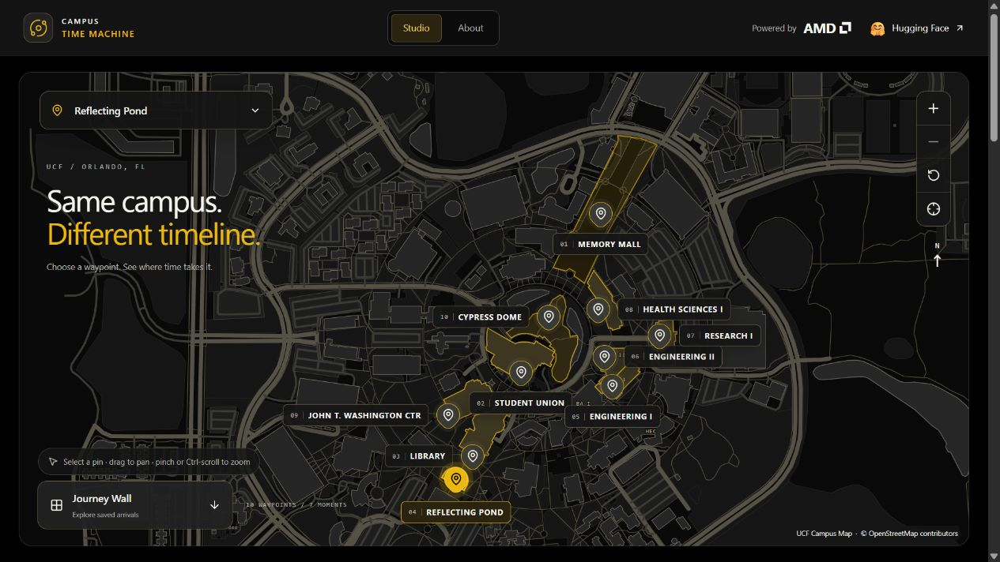
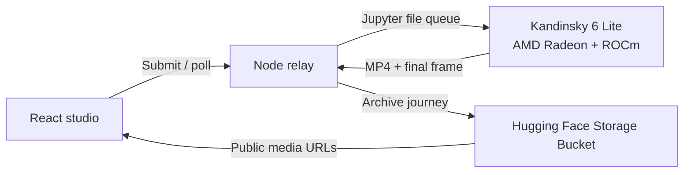

# Campus Time Machine

**Same campus. Different timeline.**

Built for [Knight Hacks IX](https://knight-hacks-ix.devpost.com/) · AI/ML · AMD: Best Use of AMD Technologies · Hugging Face: Best Use of Open Source AI

Campus Time Machine turns familiar University of Central Florida locations into imagined video moments. Choose a waypoint on the campus map, pick a photo and a moment, and generate a short video with synchronized audio. See snow in Orlando, a rocket beyond campus, or black-and-gold balloons drifting through a plaza—then compare the arrival with the original photo and explore the shared Journey Wall.



## What we built

- **A real UCF campus explorer:** ten waypoints anchored to UCF location data and OpenStreetMap geometry, with pan, zoom, keyboard controls, and a location picker.
- **Photo-based generation:** team photographs with selectable views, or a campus photo uploaded by the visitor.
- **Seven imagined moments:** The year 2125, Homecoming, Hurricane landfall, Rocket on the horizon, Wild Florida, Charge of the Knights, and Snow day in Orlando.
- **Three quality presets:** Quick, Standard, and High Detail, validated against settings supported by our AMD worker.
- **An asynchronous generation flow:** queue and rendering feedback, job recovery after reload, readable failures, and MP4 playback and download.
- **A shared Journey Wall:** finished videos, source photos, final frames, and journey records archived in a public Hugging Face Storage Bucket.

The creative experience is grounded in a place you recognize: the input is a photograph of that location, and the moment prompt describes motion within it. These are AI-imagined scenes, not historical reconstructions or forecasts.

## Explore the demo

1. Choose a campus pin, such as Student Union or Reflecting Pond.
2. Choose a photo view, a moment, and a quality. **Quick** is a useful starting point for live judging.
3. Generate a three-second Snapshot. The GPU handles one job at a time; queueing adds to the wait.
4. Play the MP4, inspect **Before / after**, download it, and open the **Journey Wall**.

Previously generated media is available in our [public Hugging Face archive](https://huggingface.co/buckets/brocw/ucf-time-machine/tree/journeys). Live inference requires the team's AMD instance and local relay; the frontend can also be tried without either using the clearly labeled interface demo below.

## AMD: inference on Radeon hardware

Our generation worker runs **Kandinsky 6.0 Video Lite (distilled)** on an **AMD Radeon Pro W7900D with 48 GB VRAM**, using **PyTorch with ROCm** on AMD Radeon Cloud. The model stays resident on the GPU and serves jobs from a file queue through the Jupyter gateway.

Making the pipeline work on this hardware required concrete engineering:

- After LTX-2.5 exceeded the instance's host-memory budget, we switched to Kandinsky Lite and kept the pipeline on the GPU, avoiding repeated model loads and CPU-offload copies.
- We pinned masked attention in the text encoder and video VAE to PyTorch's math SDPA backend after diagnosing invalid output on the available ROCm stack. Transformer attention keeps its native path.
- Tiled VAE decoding and a source-image size limit control peak memory; failed jobs report an error while the worker continues serving the queue.

Recorded pipeline timings for three-second clips on the team's W7900D:

| Studio quality | Resolution | Inference steps | Measured generation time |
| --- | --- | --- | --- |
| Quick | 640 × 352 | 6 | About 37 seconds |
| Standard | 640 × 352 | 10 | About 49 seconds |
| High Detail | 864 × 480 | 10 | About 110 seconds |

All studio presets use 24 FPS. These measurements exclude queueing, MP4 export, and any prompt expansion; they are recorded observations, not end-to-end latency guarantees. Campus moment prompts are sent without expansion. See [instance notes and benchmark history](AGENTS.md), the [worker](instance_scripts/worker_k6.py), and the [shared quality presets](src/timeMachine/quality.ts).

## Hugging Face: open model and persistent journeys

- **Model:** the [MIT-licensed Kandinsky 6.0 Lite distilled checkpoint](https://huggingface.co/kandinskylab/Kandinsky-6.0-Lite-distill-5s-Diffusers), loaded through Hugging Face Diffusers and Transformers. Inference runs on our AMD worker.
- **Storage:** [Hugging Face Storage Buckets](https://huggingface.co/docs/hub/storage-buckets-s3) hold completed journeys and their metadata. The relay signs uploads through the S3-compatible gateway; the browser plays public media URLs directly.
- **Shared archive:** teammates using the same bucket see the same Wall, and archived journeys remain accessible after the laptop relay or GPU instance stops.

The team's contribution connects the campus interaction, photo and moment conditioning, ROCm worker, asynchronous relay, and persistent gallery into a working experience. Storage credentials stay in the relay's ignored local environment file.

## How it works



The browser sends selection IDs and photos to the relay. The relay validates settings, constructs the moment prompt, queues the GPU job, and polls its status. Finished media is cached locally and uploaded to Hugging Face in the background. The Wall reads the shared archive. [Architecture details](docs/architecture.md) · [API contract](docs/api.md)

**Stack:** React 19, TypeScript, Vite, Tailwind CSS, Lucide, Node.js, Python, PyTorch/ROCm, Hugging Face Diffusers and Transformers, and Hugging Face Storage Buckets.

## Run the frontend without a GPU

Requires **Node.js 22.18 or newer** and npm.

```sh
git clone https://github.com/Ywrd10/Campus-Time-Machine.git
cd Campus-Time-Machine
npm ci
npm run dev
```

Open the URL printed by Vite, normally **http://127.0.0.1:5173/**. If that port is occupied, Vite chooses the next free port.

A fresh clone defaults to **mock mode**. It exercises the interface and job lifecycle using a bundled six-second landscape MP4. This fixed, labeled sample is independent of the selected place, moment, and quality; it does not perform AI inference. Files uploaded in mock mode stay in the browser.

## Connect to the live AMD backend

1. Prepare the AMD instance and start `worker_k6.py` using the [instance setup notes](AGENTS.md). Live inference needs access to the team's cloud instance.
2. Create `relay/.env.local` using [relay/.env.example](relay/.env.example) as a guide. Set `RADEON_SESSION` locally. To enable the shared archive, also set `HF_BUCKET`, `HF_S3_KEY_ID`, and `HF_S3_SECRET`. Preserve existing local configuration when updating these values.
3. Set these public frontend options in a separate `.env.local` at the project root:

   ```dotenv
   VITE_GENERATION_PROVIDER=http
   VITE_API_BASE_URL=/api
   ```

4. Run the relay in one terminal:

   ```sh
   npm run relay
   ```

5. Start or restart Vite in another terminal:

   ```sh
   npm run dev
   ```

The Vite `/api` proxy connects to the relay on `127.0.0.1:8000`. Open `/api/health` on the frontend URL to check the instance and worker connection.

`VITE_` variables are public. Keep cookies and storage credentials only in the ignored `relay/.env.local`. With the public archive enabled, uploaded source photos and generated journeys are publicly accessible. Without bucket configuration, the relay uses its local cache and Wall index.

## Verification and current scope

```sh
npm test
npm run build
```

The 27-test suite covers settings, request validation, generation and timeline lifecycle, reload persistence, map controls, progress states, and frontend-to-relay integration using a local Jupyter fixture. The production build runs strict TypeScript checks. Live AMD generation, archived MP4 seeking, and the shared Wall have also been exercised; see the [verification log](docs/verification.md).

The mounted studio creates single three-second image-to-video Snapshots. The backend also retains a text-to-video endpoint. Audio-input generation, multi-shot films, and super-resolution are outside the current demo. Output varies with the photo and moment; large portrait photos are resized and center-cropped. Quick renders can have quieter audio. The automated relay fixture does not currently test the Hugging Face upload and recovery paths.

## Team and credits

- [**Broc Weselmann**](https://www.linkedin.com/in/brocweselmann/) — model integration, AMD inference, and backend relay/storage.
- [**Diego Rolon**](https://www.linkedin.com/in/diego-rolon-487026338/) — React/TypeScript frontend, campus explorer, and generation experience.

Kandinsky is developed by [Kandinsky Lab](https://huggingface.co/kandinskylab). The basemap credits **OpenStreetMap contributors**, with waypoint data from **UCF Campus Map**; [map provenance and licensing](public/maps/README.md) are documented separately. AI coding tools, including Codex and Claude, assisted implementation and debugging.

## Further documentation

- [Frontend behavior](docs/frontend.md)
- [Campus map and photo flow](docs/frontend-map.md)
- [Backend architecture](docs/architecture.md)
- [HTTP API](docs/api.md)
- [Verification log](docs/verification.md)
- [AMD instance operations and lessons learned](AGENTS.md)
